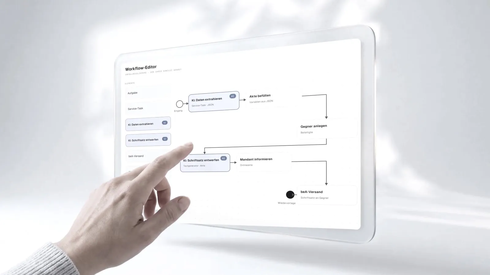

# DEPLAW-Skill für Claude Code

Der DEPLAW-Skill für Claude Code erzeugt Workflows, Formulare, Textbausteine und Extraktionsvorlagen für
[DEPLAW](https://legaldata.tech/was-ist-deplaw), die Legal-Tech-Plattform für juristische Massenverfahren, und prüft sie
automatisch. Sie beschreiben den gewünschten Ablauf in eigenen Worten, der Skill liefert eine importierbare Datei.

*So sieht ein Workflow im Workflow-Editor von DEPLAW aus: KI-Schritte, Akte befüllen, Mandant informieren, beA-Versand.
Solche Abläufe erzeugt der Skill als BPMN-Datei.*

## Was der Skill erzeugt

| Artefakt | Format | Wofür |
|---|---|---|
| Workflow | BPMN 2.0 (XML) | Fallabläufe mit Fristen, KI-Schritten, beA-Versand und Wiedervorlagen |
| Formular | JSON | Nachsende- und Akquiseformulare, dynamische Eingabemasken |
| Textbaustein | JSON | Schreiben und E-Mails mit Platzhaltern und Bedingungen |
| Extraktionsvorlage | JSON | Daten aus eingehenden Dokumenten auslesen |

## So arbeitet der Skill

1. **Anfrage einordnen:** Der Skill ordnet Ihre Beschreibung einem oder mehreren Artefakttypen zu.
2. **Referenzen lesen:** Er liest die Plattform-Konventionen von DEPLAW, bevor er etwas erzeugt.
3. **Artefakt erzeugen:** BPMN-XML oder JSON nach den dokumentierten Regeln der Plattform.
4. **Automatisch prüfen:** Eine Pflicht-Checkliste wird abgearbeitet; Fehler korrigiert der Skill selbst und prüft erneut.
5. **Ergebnis übergeben:** fertige Datei plus Zusammenfassung mit ID, verwendeten Bausteinen und offenen Annahmen.

**Beispielanfrage:**
> Lege einen Workflow an: Geht ein Schreiben der Gegenseite ein, wird eine Frist von zwei Wochen notiert, der Mandant
> per E-Mail informiert und nach Fristablauf eine Wiedervorlage für die Sachbearbeitung erzeugt.

## Voraussetzungen

- [Claude Code](https://claude.com/claude-code)
- ein DEPLAW-System, in das die erzeugten Dateien importiert werden

## Bezug

Den Skill erhalten Sie über den DEPLAW-Marketplace:
**[DEPLAW-Skill für Claude Code anfordern](https://legaldata.tech/marketplace/deplaw-automation-generator-skill)**

Hintergrund: [DEPLAW macht die Kanzlei zur KI-Kanzlei](https://legaldata.tech/ressourcen/insights/deplaw-ki-kanzlei-claude-code)
· [Dokumentation](https://legaldata.tech/docs) · [Demo anfragen](https://legaldata.tech/demo)

## English

The DEPLAW skill for Claude Code creates workflows (BPMN 2.0), forms, text blocks and extraction templates for
[DEPLAW](https://legaldata.tech/en/what-is-deplaw), the legal tech platform for mass proceedings, from a plain-language
description and validates them automatically. It is available through the
[DEPLAW marketplace](https://legaldata.tech/marketplace/deplaw-automation-generator-skill).

---

Dieses Repository enthält nur Beschreibung und Bilder, nicht den Skill selbst.
Herausgeber: [Legal Data Technology GmbH](https://legaldata.tech), Wuppertal · info@legaldata.tech
