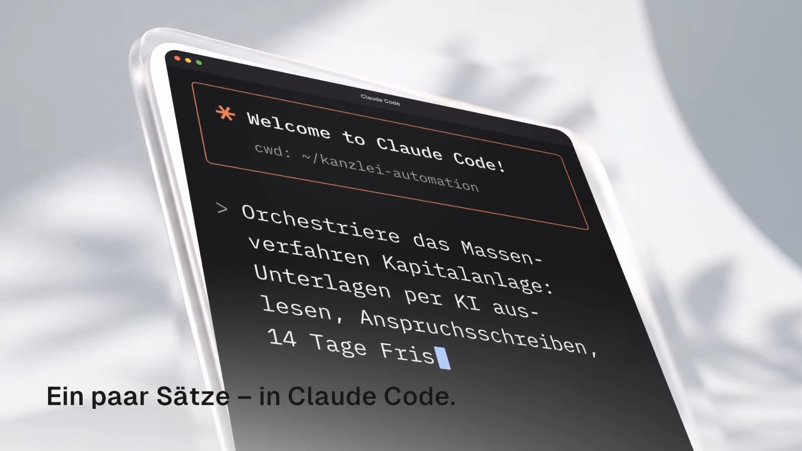
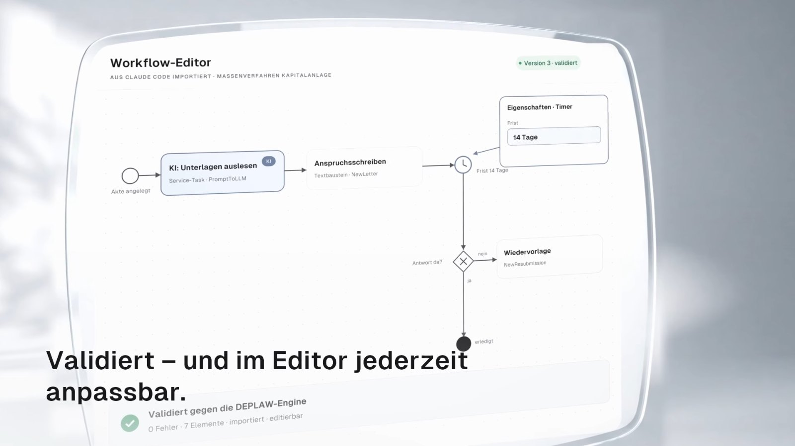

# DEPLAW-Skill für Claude Code: Mandate mit KI über BPMN-Workflows automatisieren

Mit dem DEPLAW-Skill für Claude Code beschreiben Kanzleien, Versicherer und Rechtsabteilungen in ein paar Sätzen, wie
ein Mandat bearbeitet werden soll. Claude Code baut daraus einen echten BPMN-Workflow mit KI-Schritten, Fristen,
Schreiben und beA-Versand. [DEPLAW](https://legaldata.tech/was-ist-deplaw), die Legal-Tech-Plattform für juristische
Massenverfahren, führt diesen Workflow dann für jedes einzelne Mandat aus.

**1. Den Ablauf in Claude Code beschreiben**

> Orchestriere das Massenverfahren Kapitalanlage: Unterlagen per KI auslesen, Anspruchsschreiben, 14 Tage Frist …

**2. Ein BPMN-Workflow entsteht, geprüft und im Editor von DEPLAW anpassbar**

**3. DEPLAW bearbeitet jedes Mandat nach diesem Workflow:** KI liest eingehende Unterlagen aus, Schreiben entstehen aus
Textbausteinen, Fristen und Wiedervorlagen laufen mit, der Versand geht über beA. Menschen geben dort frei, wo es
juristisch darauf ankommt.

▶ **Film (1 Minute):** [Der DEPLAW-Skill für Claude Code](https://legaldata.tech/ressourcen/insights/deplaw-ki-kanzlei-claude-code)

## Was der Skill erzeugt

| Artefakt | Format | Wofür |
|---|---|---|
| Workflow | BPMN 2.0 (XML) | Mandatsabläufe mit KI-Schritten, Fristen, Schreiben, beA-Versand und Wiedervorlagen |
| Formular | JSON | Nachsende- und Akquiseformulare, dynamische Eingabemasken |
| Textbaustein | JSON | Schreiben und E-Mails mit Platzhaltern und Bedingungen |
| Extraktionsvorlage | JSON | Daten aus eingehenden Dokumenten per KI auslesen |

## So arbeitet der Skill

1. **Anfrage einordnen:** Der Skill ordnet Ihre Beschreibung einem oder mehreren Artefakttypen zu.
2. **Referenzen lesen:** Er liest die Plattform-Konventionen von DEPLAW, bevor er etwas erzeugt.
3. **Artefakt erzeugen:** BPMN-XML oder JSON nach den dokumentierten Regeln der Plattform.
4. **Automatisch prüfen:** Eine Pflicht-Checkliste wird abgearbeitet; Fehler korrigiert der Skill selbst und prüft erneut.
5. **Ergebnis übergeben:** fertige Datei plus Zusammenfassung mit ID, verwendeten Bausteinen und offenen Annahmen.
   Importiert, versioniert und geprüft wird in DEPLAW, nicht in der KI.

## Mandatsdaten bleiben in DEPLAW

Claude Code baut nur den Workflow. An der eigentlichen Fallbearbeitung ist Claude Code nicht beteiligt: Mandatsdaten,
Kommunikation über beA und die Ausführung der Workflows bleiben vollständig in DEPLAW.

## Bezug

Den Skill erhalten DEPLAW-Kunden über den DEPLAW-Marketplace:
**[DEPLAW-Skill für Claude Code anfordern](https://legaldata.tech/marketplace/deplaw-automation-generator-skill)**

Mehr: [Anleitung: Workflows mit Claude Code bauen](https://legaldata.tech/docs/workflows/claude-code)
· [Pressemitteilung](https://legaldata.tech/ressourcen/insights/deplaw-ki-kanzlei-claude-code)
· [Demo anfragen](https://legaldata.tech/demo)

## English

**Automate legal cases with LLMs through BPMN workflows.** With the DEPLAW skill for Claude Code, law firms, insurers
and legal departments describe in a few sentences how a case should be handled. Claude Code turns this into a real
BPMN 2.0 workflow with AI steps, deadlines, letters and dispatch via beA (Germany's electronic lawyer mailbox), plus
forms, text blocks and extraction templates, validated automatically. [DEPLAW](https://legaldata.tech/en/what-is-deplaw),
the legal tech platform for mass proceedings, then runs that workflow for every single case. Case data never leaves
DEPLAW. Available to DEPLAW customers through the
[DEPLAW marketplace](https://legaldata.tech/marketplace/deplaw-automation-generator-skill).

---

Dieses Repository enthält nur Beschreibung und Bilder, nicht den Skill selbst.
Herausgeber: [Legal Data Technology GmbH](https://legaldata.tech), Wuppertal · info@legaldata.tech
